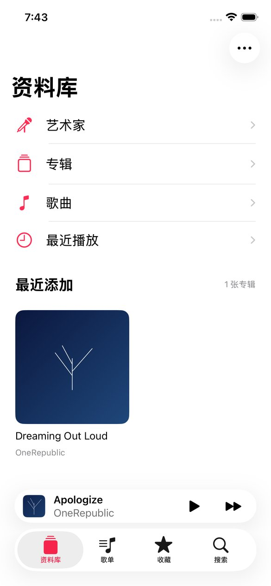
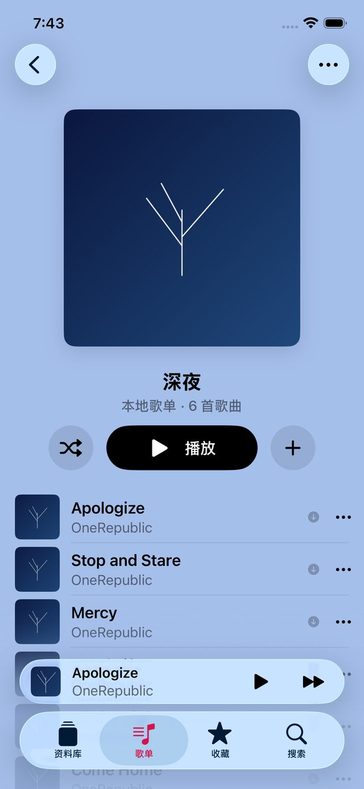
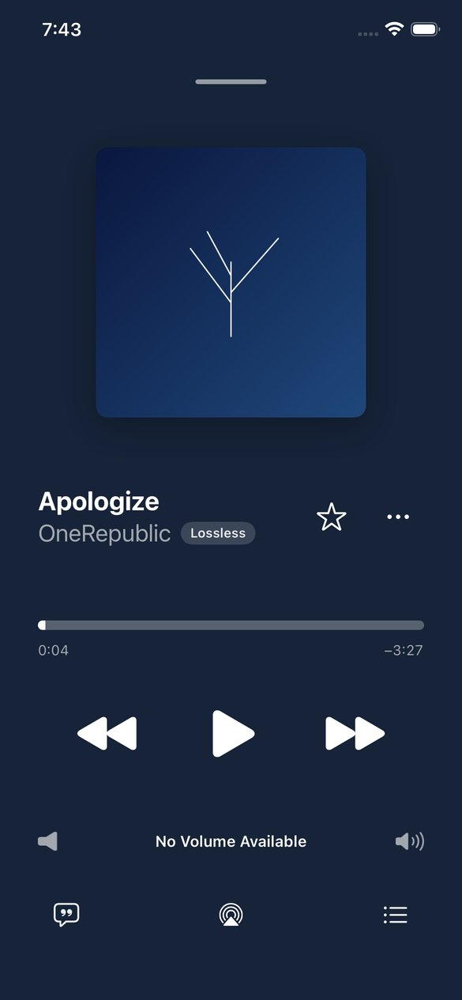
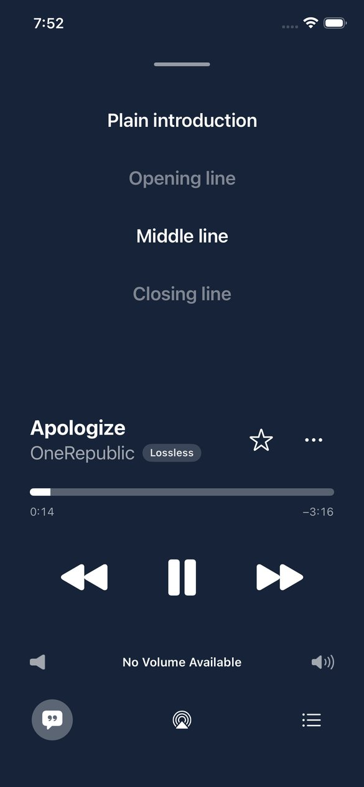
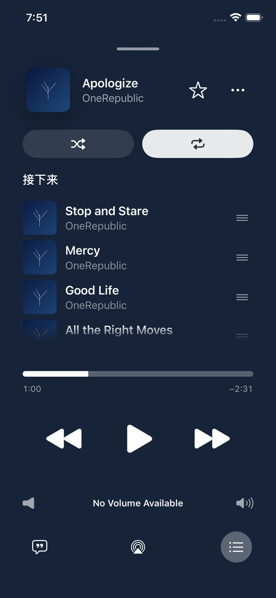

# Lossless

English | [简体中文](README.zh-CN.md)

Lossless (原音) is a local music player for iOS 17+, built with SwiftUI and AVFoundation, with no account and no server. Playback runs through a pass-through `AVAudioEngine` chain: each track asks for its own sample rate, no effects sit in the engine, and digital volume stays at 100%. The playback path is judged from the actual session sample rate and output route: only when the source is lossless, the sample rates match and the output is wired or USB is it labelled Bit-Perfect (conditions met); otherwise it says plainly resampled, wireless or lossy. 0.2 keeps the original note / vinyl icon, uses the Music pink as the accent, and uses the system Liquid Glass on iOS 26 / 27, with native materials on older systems.

<p align="center">
  
  
  
  
  
</p>

## Install

Add this source in Zeus (or AltStore or another tool that supports install sources):

```
https://raw.githubusercontent.com/iskerwin/LosslessPlayer/main/apps.json
```

The source lists the latest development build and, after it, the latest preview build (for checking on a phone before merging), with the Lossless icon. Each development or preview release updates the source automatically. The packages are unsigned IPAs that the install tool re-signs.

## Library and playback

- Four tabs: Library, Playlists, Favorites and Search; songs, artists, albums and recently played. Search results are grouped the Apple Music way: artists, albums, songs, with songs ranked by where they match (title first, then artist, then album).
- Global search, song lists, album / artist tracks, recently played, favorites, playlists and the song picker share fuzzy matching: partial words and several non-adjacent keywords work, ignoring case, extra spaces, diacritics and character width. Keywords can match title, artist, album and other tags separately, and all of them must match. The library's artist and album indexes and the playlists page are searchable too. List search keeps the original order, and Play, Shuffle and tapping a song all use the filtered result; clearing the search brings back every song, and no match shows an empty result. A playlist's cover, total count and export keep its full contents, and entering edit mode clears the search. Global search includes a section of playlists matched by name, so even empty playlists can be found.
- Albums are grouped by album artist. Tracks without an album artist but marked as a compilation are grouped into one album by album name.
- Playlists have their own tab and switch between a list and a cover grid. They can be renamed, reordered by dragging, given a cover, filled from the library, and imported or exported as m3u/m3u8.
- Song, album, artist, favorites, recently played and search lists have two equal-width buttons: Play plays the list from the top, Shuffle plays it shuffled. They show no pause state or highlight. On iOS 26 they use the system Liquid Glass, and pink appears only on text, icons, the selected tab and the playing song's title. Shuffle and repeat are switched only in the Now Playing queue and follow the global state. Light and dark follow the system.
- A song row has a rounded cover, title and artist. The current song's title is in the accent color (white on immersive playlist pages), with a waveform while playing. Long-press and the trailing ellipsis open the same menu: favorite, add to playlist, play next, play later, go to album, go to artist, view full lyrics (when there are lyrics), and remove from library. Albums, artists and playlists have matching play and queue menus.
- Playlist details use an immersive background tinted from the cover, a centered cover 65% of the screen width, a round shuffle button, a white play capsule and an add-songs button; the song count and total length stay at the bottom.
- The Now Playing screen follows the provided Apple Music screenshots for cover proportion, title, control spacing, a 4pt progress line and a subdued volume bar; it follows the finger when pulled down and springs back short of the threshold. Audio quality details open from the More menu.
- Embedded cover thumbnails, song info, a floating mini player and a full player that can be pulled down to close.
- Native tab bar, toolbars and menus; glass materials on navigation and controls. Dynamic Type, VoiceOver and Reduce Transparency are supported.
- Favorites, play next and play later; drag to reorder or remove in the queue, repeat one / all, shuffle. The repeat and shuffle switches live in Now Playing, not on list pages.
- Seeking, system volume, audio output selection, background and lock screen controls, headphone unplugging and incoming calls.
- UTF-8 `.lrc` lyrics with the same name as the song; songs with lyrics show a lyrics icon at the end of their row. Lyrics and wrapped text are centered. With timestamps they scroll automatically and highlight the current line, and tapping a line jumps to its start and plays (resuming if paused); text without timestamps is for reading only. Now Playing and the full lyrics page behave the same.
- No Apple Music branding, streaming catalogue, subscription, online radio, online lyrics or DRM decryption.

## Scanning local folders

1. Tap `+` at the top right of Library → Add Music Folder, and pick a folder reachable in Files.
2. The system access bookmark is saved, subfolders are scanned recursively, and the original files are indexed and played in place; the folder is not copied.
3. Rescan from `+` → Manage Folders, with progress, cancel and incremental updates. The disk is not watched in the background.
4. Entries are deduplicated by authorized folder + relative path, keeping song IDs, favorites and playlist membership; metadata is updated when size or modification date changes.
5. When an original file is removed, its entry stays and is marked missing; a permission or traversal failure, or a cancel, never removes library entries in bulk.
6. Removing an entry only removes the index and remembers the excluded path; removing a folder clears its access and its entries, and never deletes the music files in it.

Importing individual files still copies them into the app, with a streaming SHA-256 to avoid importing the same content twice. Files indexed in place at different paths are not deduplicated by content across folders, so scanning a large library doesn't read all the audio.

FLAC, ALAC/M4A, WAV, AIFF, CAF, MP3 and AAC are supported; what actually decodes depends on the device's system. M4A may be lossy AAC, so the extension alone doesn't make it lossless. iCloud and third-party file providers may need to download or re-authorize; a local offline folder is recommended. The system sandbox doesn't allow scanning the whole phone without permission.

## Building and development builds

With Xcode 27 and XcodeGen:

```sh
brew install xcodegen
xcodegen generate
open LosslessPlayer.xcodeproj
```

It runs on iOS 17 and later; the Liquid Glass branch needs iOS 26+. The project is generated from `project.yml`, and the generated project and Info.plist aren't committed. Set your own Signing Team to run it on a device.

Tests, builds and releases all run on GitHub-hosted `macos-26` runners (Xcode 26, iOS 26 simulator); locally you only edit, run `python3 tools/ship.py check` and start cloud jobs. The flow is: branch → PR check (`Lossless CI / gate`) → a preview build on the phone when needed → merge → a development build by hand with `python3 tools/ship.py dev`. Development and preview builds compile an optimized arm64 Release app, check the bundle ID, background audio capability, icon and binary architecture, produce an unsigned IPA and SHA256SUMS, and update the AltStore source `apps.json`. Unsigned IPAs must be re-signed by a tool such as AltStore; they are not TestFlight or App Store releases. See [Cloud testing and release (Chinese)](docs/ci-and-release.md) for the details.

## Verification and limits

When changing tracks with the same decoding format, the existing engine connection is reused, and the old track no longer replays briefly before the new one takes over. Bluetooth and AirPlay keep the output sample rate the system chose, rather than asking for a new rate per track and reconfiguring the wireless output; wired and USB still ask for the source's rate. Automated tests cover connection continuity and the sample rate policy; whether Bluetooth pops are gone still needs listening on a real device.

Interface sizes, interaction rules, Apple's guidance and how to accept it on an iOS 27 device are in the [iOS player interface spec (Chinese)](docs/ios-ui-spec.md). Values such as the 3pt progress track and 44pt hit areas are this project's baseline; Apple Music's exact visual proportions still need a side-by-side check on the same device.

Automated tests cover migrating an old library, copying imports and deduplication, queue edges, inserting play next and play later, list capsules not following playback state, shuffle and repeat in Now Playing, song menu wording, recursive scanning and rescanning, keeping favorites and playlists, playlist rename, ordering and m3u, album artist / genre / disc number tags, folder covers, play counts, missing files, removal not deleting originals, scan cancel, LRC parsing, playback path judgment (resampled / wireless / digital volume / Bit-Perfect conditions), and the library index with backup and recovery (format version, recovering from the last good copy when the main file is corrupt). UI screenshots and xcresult bundles are kept with each CI run.

Still to be accepted on a real device, with steps in [docs/device-verification.md](docs/device-verification.md) (Chinese): restoring access after a restart, moving an authorized folder, iCloud offline files, lock screen cover, unplugging headphones, memory with large FLAC files, and whether the file format matches the session sample rate.

Playback goes through the pass-through `AVAudioEngine` chain and the iOS system output. Per-track sample rate following is implemented, but whether the system accepts it depends on hardware and route (built-in output tops out at 48 kHz, above that needs an external DAC; Bluetooth / AirPlay can't be bit-exact), so bit-exact output isn't guaranteed on every route. Tracks with the same decoding format switch gaplessly, while different formats go through the original track-change path. The Playback Path in song info is judged from the actual session sample rate and route; the file format is not the device's actual output. DSD, APE, CUE, NAS and CarPlay are not implemented. Albums are grouped by album artist; without an album artist but marked as a compilation, they are grouped by album name. Shuffle remembers the original order and restores it when turned off; lyrics support the LRC offset tag (milliseconds, positive earlier, negative later). Scanning stays within authorized paths and ignores hidden files, symbolic links and package directories. A `cover.jpg` / `folder.jpg` in the same folder is used as the cover when there is no embedded one.

## This round's interface rework

Changes and how to accept them are in [Apple Music style rework (Chinese)](docs/apple-music-restyle.md). This round only changed source and checked the diff statically; the Linux environment it was made in had no Xcode / iOS SDK, so it wasn't compiled or run through XCTest, and there is no simulator or device visual acceptance yet.
